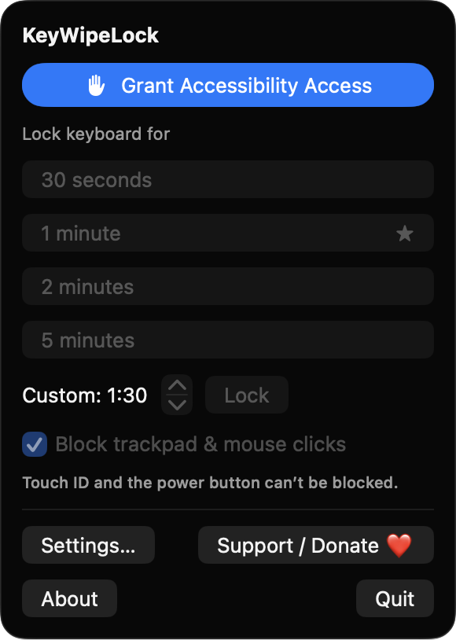
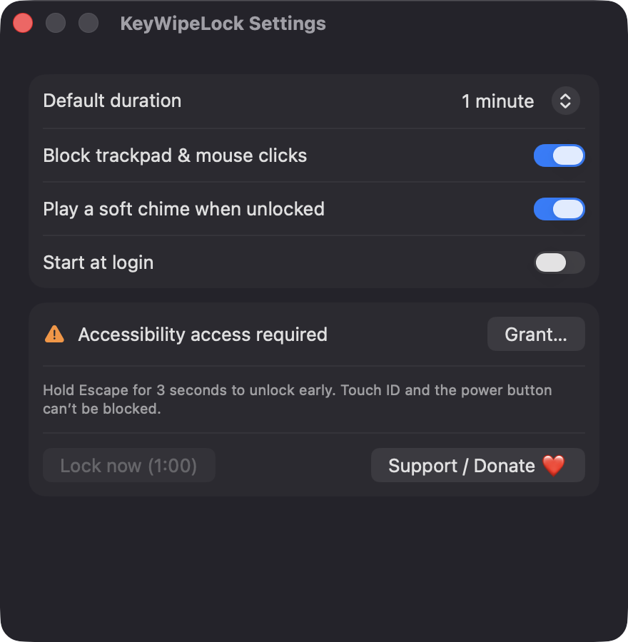

# KeyWipeLock

**🌐 Website:** [turhe123.github.io/key-wipe-lock](https://turhe123.github.io/key-wipe-lock/)

Lock your keyboard and trackpad for a countdown so you can wipe them clean without typing nonsense.


## Why

KeyWipeLock is a free, open-source, 100% native, backend-free alternative to paid utilities in the *Text & Input* category. It was inspired by Real Keyboard Cleaner ($5.99 one-time), which showed there is steady demand for a simple "lock my keyboard while I clean it" tool. Everything here runs locally, with no accounts, servers or tracking.

## Features

- **Menu bar app** with a keyboard icon (it switches to a lock icon while locked).
- **Preset durations:** 30 seconds, 1, 2 or 5 minutes, plus a **custom duration** stepper (10 seconds to 30 minutes, in 10-second steps).
- **Blocks all keyboard input**, including modifier keys and media/special keys (system-defined events), using a session-level `CGEventTap`.
- **Optionally blocks the trackpad and mouse:** clicks, drags, scrolling and trackpad gestures. Toggle it from the menu or Settings.
- **Full-screen overlay on every display** at screen-saver level, with a dimmed translucent background, a countdown ring and the remaining time.
- **Emergency exit:** hold Escape for 3 seconds (a progress bar shows the hold), or wait for the timer. Quitting the app also always releases the keyboard.
- **Extend a running lock:** starting another lock while locked adds time to the current one.
- **Resilient:** the overlay is rebuilt after display changes or wake from sleep, keeping the same end time. If macOS disables the event tap, the app tries to re-enable it, and if that fails it unlocks and sends a notification.
- **Settings:** default duration, block trackpad and mouse clicks, a soft end-of-lock chime, and start at login.
- **First-run explainer** that walks you through granting Accessibility access.
- **Honest limits:** Touch ID and the power button cannot be blocked, and the app says so in the UI.

## Screenshots

<p align="center"></p>

<p align="center"><em>The menu bar panel with one-click lock presets (30 s to 5 min), a custom duration stepper, the trackpad and mouse blocking toggle, and a prompt to grant Accessibility access on first run.</em></p>

<p align="center"></p>

<p align="center"><em>Settings for the default lock duration, trackpad and mouse blocking, an unlock chime and start at login, plus Accessibility status and the hold-Escape emergency exit reminder.</em></p>

## Install

1. Download `KeyWipeLock-macOS.zip` from the [latest release](https://github.com/turhe123/key-wipe-lock/releases/latest).
2. Unzip it and move `KeyWipeLock.app` to `/Applications`.
3. Because the app is open source and not notarized, clear the quarantine flag:

   ```bash
   xattr -cr /Applications/KeyWipeLock.app
   ```

4. The first time, right-click the app and choose **Open**.

## Build from source

Requires macOS 14+ and Xcode with Swift 5.9+.

```bash
brew install xcodegen
xcodegen generate
xcodebuild -project KeyWipeLock.xcodeproj -scheme KeyWipeLock -configuration Release -derivedDataPath ./build build
```

The app is produced at `build/Build/Products/Release/KeyWipeLock.app`.

## Permissions

| Permission | Why |
| --- | --- |
| **Accessibility** (required) | macOS only allows an app to intercept and swallow keyboard and pointer events if it is trusted for Accessibility. Without it the lock buttons are disabled and the menu shows "Grant Accessibility Access". |
| **Notifications** (optional) | Only requested if macOS disables the input blocker mid-lock, so the app can tell you it unlocked early. |
| **Login item** (optional) | Only used if you turn on "Start at login" in Settings (via `SMAppService`). |

KeyWipeLock does **not** request Screen Recording or Microphone access, and it does not read or record what you type. Key events are discarded; the only key it looks at is Escape, to time the 3-second hold.

## Built with AI

KeyWipeLock was written by [Claude Code](https://claude.com/claude-code) inside an automated pipeline, from a plain-English spec. No code, binaries or assets from any commercial app were used; it is a clean-room reimplementation of a feature set, not a copy.

What that means in practice:

- The full source is in this repo under the MIT license. Read it before you run it.
- No network calls, no analytics, no third-party dependencies. Only Apple frameworks.
- Ad-hoc signed and not notarized, which is why Gatekeeper warns on first launch.
- It has had less human review than a hand-written app. Bug reports and pull requests are welcome.

## Support ❤️

If KeyWipeLock saved you from typing nonsense, you can [Support Or (Leo) Davidai ❤️ on Ko-fi](https://ko-fi.com/leodavidai).

## License

MIT © Or Davidai Bachar
